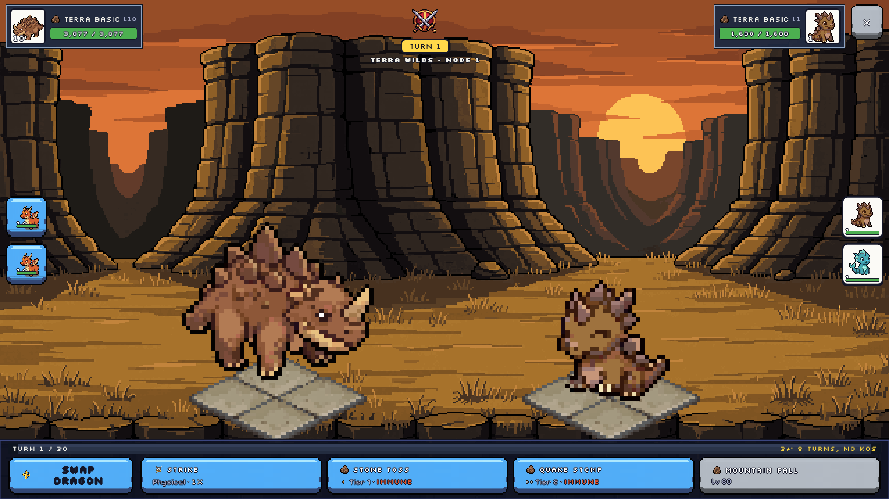
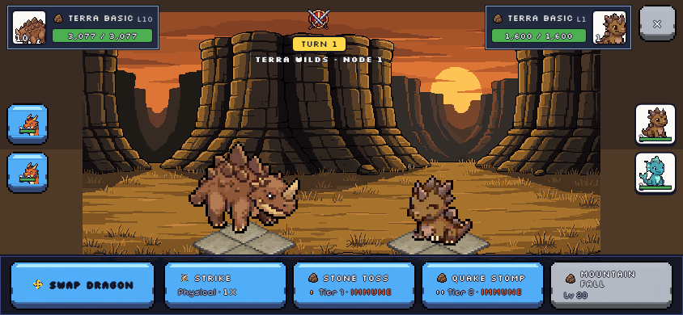
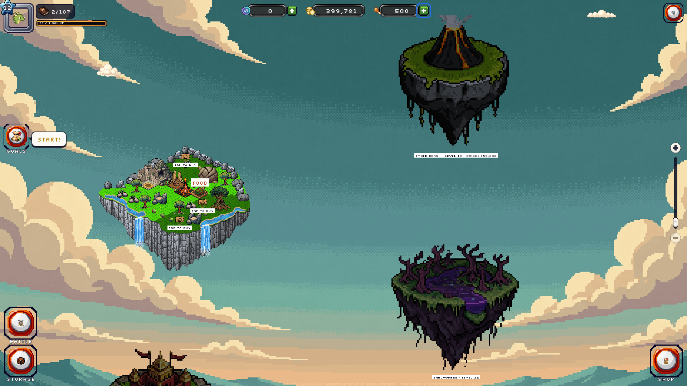
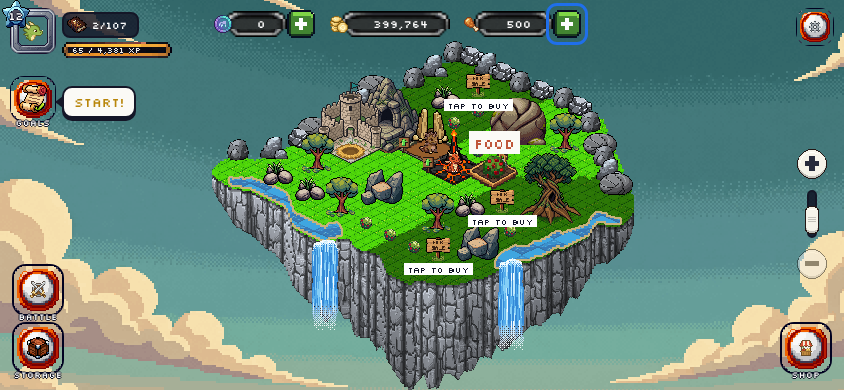
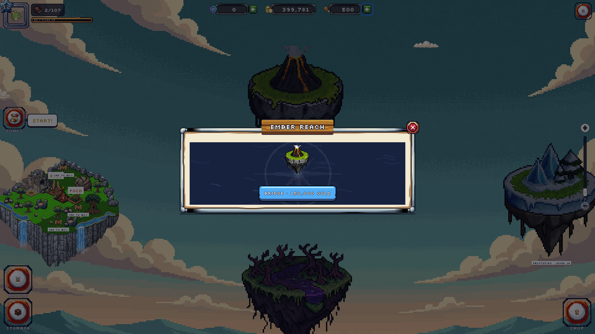
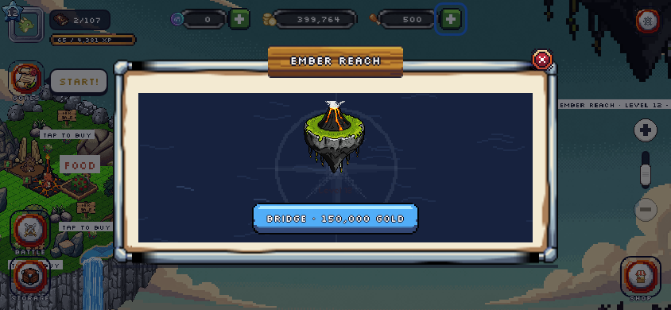
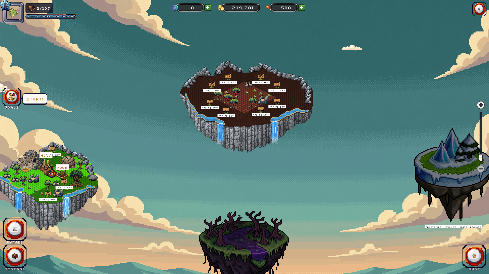
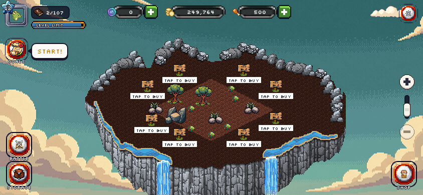

# UI Rework Phase 6 report: landscape combat, every island in one scene

Plan: `docs/superpowers/plans/2026-11-06-ui-rework-phase6.md` (rulings R98–R102). Branch `claude/project-thread-orpmoo`, not merged.

Asked on 2026-11-06: "I don't see any changes in the combat screen, as well as only one island per scene. I want all island in 1 scene, remove the map."

## What changed

**Combat (R98, R101, R102), laid out like `combat.png`:**
- The stage is now landscape, 640×360. It is zoomed by whole numbers and centred. Both dragons stand on one ground line, facing each other.
- The art thread's landscape backdrops (`battle.wide.<element>`) are used. A cropped portrait backdrop is the fallback.
- The top row holds:
  - your plate on the left (portrait, name, level, HP bar);
  - the VS badge, turn and title in the middle;
  - the enemy plate and Exit on the right.
- Bench portraits run down each side. Yours are "Swap to X" buttons; the enemy's show alive, hurt or KO.
- A full-width bar along the bottom holds Swap Dragon and the four moves (2×2 under 600 px wide).

**Islands (R99, R100), laid out like `all-island-layout.png`:**
- The Map scene and the Map button are gone. Every island is drawn in the island scene at its own world offset, with Home first and the chain zig-zagging right.
- A desktop window opens zoomed out on Home and Ember Reach. A phone opens on Home's land.
- Locked islands show their greyed floating-island art with a caption: name, level and, for the next one, the Bridge price. A tap opens the island panel to buy the Bridge.
- After a Bridge is bought, the island turns into land without a reload, and Go pans the camera there.
- Tapping an island, or panning to it, makes it the island you are working on. Placement and "Move to" follow it.

## Screenshots

| | 1920×1080 | 844×390 |
| --- | --- | --- |
| Battle |  |  |
| All islands, zoomed out |  |  |
| Locked island's panel |  |  |
| Ember Reach after Go |  |  |

References (layout only, not committed): `/mnt/project-files/combat.png`, `/mnt/project-files/all-island-layout.png`.

## Verification

- `pnpm -r typecheck` is clean.
- Web unit tests: 72 files, 994 tests passed. game-core is untouched.
- Playwright e2e: 50 passed, 1 skipped (existing skip). New `e2e/islands.spec.ts`; `map.spec.ts` was removed.
- Real-input playtest at 1920×1080 and 844×390 passed with no page errors. It covered:
  - each object's row, Storage, every HUD dialog and the plus buttons;
  - zooming out, a drag to Ember Reach, a click on its caption, the Bridge and Go;
  - a plot sign on Ember Reach and Move with OK.

## Rough edges

- On 844×390 the battle stage stays at zoom 1, so dark strips show left and right of the backdrop. A wider backdrop or extending its edge colours would fill them.
- Zoomed out to 1, Home's land looks small next to the locked islands' ×4 art, and the locked captions are small text.
- At 1920 the opening view sits between Home and Ember Reach, so the lower island (Shadowmere) is cut by the screen edge.
